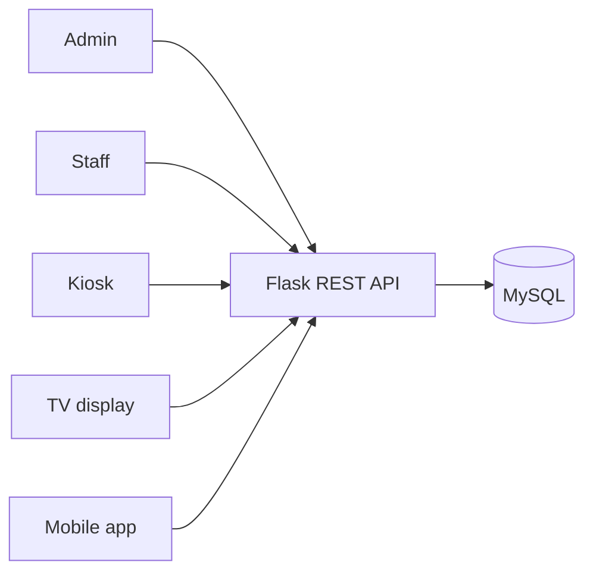

# PCDS Queue

### Campus Queue Management System

One connected queue experience for campus administrators, service staff, and students.

[**Download Windows apps**](https://github.com/nardvyn/PCDS-Queue/releases/latest) ·
[Deployment guide](DEPLOYMENT.md) ·
[System architecture](docs/01_Project_Overview/System_Architecture.md)

PCDS Queue brings campus services together in a single system. Students can
join a queue from a self-service kiosk or mobile app, while staff serve
customers and administrators manage service operations.

## Product preview

| Admin dashboard | Staff console |
|:---:|:---:|
|  |  |

| Self-service kiosk | Live queue display |
|:---:|:---:|
|  |  |

| Mobile app |
|:---:|
|  |

## Applications

| Application | What it does |
|---|---|
| **Admin** | Manage departments, service windows, staff accounts, settings, and queue operations. |
| **Staff** | Call and serve customers at the assigned service window. |
| **Kiosk** | Let walk-in visitors choose a service and get a queue ticket. |
| **TV Display** | Show live queue calls and waiting counts to visitors. |
| **Mobile** | Let students scan a service QR code, join a queue, and follow ticket updates. |

The desktop applications are published as Windows x64 installers. The Android
app is built separately; see the [deployment guide](DEPLOYMENT.md).

## Download

Get the latest version from **[GitHub Releases](https://github.com/nardvyn/PCDS-Queue/releases/latest)**:

- [Admin installer](https://github.com/nardvyn/PCDS-Queue/releases/download/v1.0.0/PCDS.Queue.Admin.Setup.exe)
- [Staff installer](https://github.com/nardvyn/PCDS-Queue/releases/download/v1.0.0/PCDS.Queue.Staff.Setup.exe)
- [Kiosk installer](https://github.com/nardvyn/PCDS-Queue/releases/download/v1.0.0/PCDS.Queue.Kiosk.Setup.exe)
- [TV Display installer](https://github.com/nardvyn/PCDS-Queue/releases/download/v1.0.0/PCDS.Queue.TV.Display.Setup.exe)

Choose the installer for the computer's role. The current desktop release is
unsigned, so Windows may display a SmartScreen or unknown-publisher warning.
Installers are self-contained and include the .NET runtime.

## How it works

Each client communicates with the Flask API; only the API connects to MySQL.
This keeps database access on the server and gives desktop, kiosk, TV, and
mobile clients a shared queue service.

## Technology

- **Backend:** Python, Flask, MySQL
- **Desktop, kiosk, and display:** C#, .NET, WPF
- **Mobile:** React Native, Expo
- **API hosting:** Railway

The shared visual identity uses teal `#077F8D` as its primary brand color.

## Run and deploy

For production setup, database preparation, API configuration, desktop
publishing, and Android builds, follow the **[deployment guide](DEPLOYMENT.md)**.
The database setup and API deployment details are in the
[database guide](database/README.md) and [backend](backend/) directory.

## Repository layout

| Path | Contents |
|---|---|
| [`backend/`](backend/) | Flask REST API and production server |
| [`database/`](database/) | MySQL schema, migrations, and seed data |
| [`desktop/`](desktop/) | WPF Admin and Staff applications |
| [`kiosk/`](kiosk/) | WPF self-service kiosk |
| [`tv-display/`](tv-display/) | WPF live queue display |
| [`mobile/`](mobile/) | React Native student application |
| [`docs/`](docs/) | Project and architecture documentation |

## Project information

- [Deployment guide](DEPLOYMENT.md)
- [System architecture](docs/01_Project_Overview/System_Architecture.md)
- [Database documentation](database/README.md)
- [Release history and downloads](https://github.com/nardvyn/PCDS-Queue/releases)
